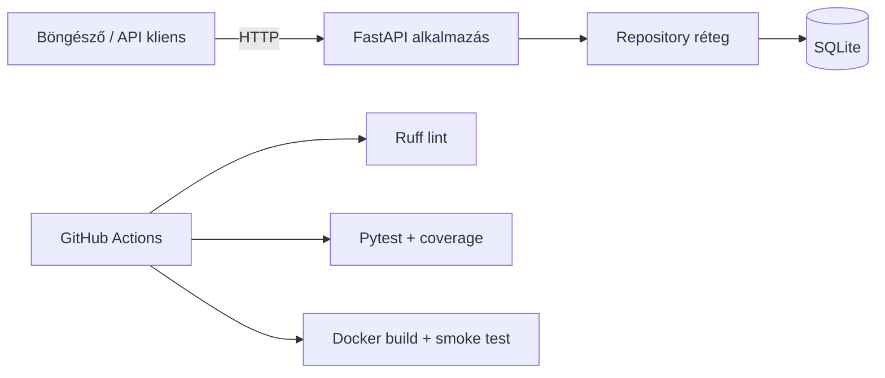

# TaskFlow – tesztautomatizálási és DevOps demó

[](https://github.com/USERNAME/taskflow-devops/actions/workflows/ci.yml)
[](https://www.python.org/)
[](https://fastapi.tiangolo.com/)
[](https://www.docker.com/)

A **TaskFlow** egy kis feladatkezelő webalkalmazás, amelynek fő célja egy modern tesztautomatizálási és DevOps-folyamat bemutatása. A projekt elég kicsi ahhoz, hogy egy egyetemi prezentáción áttekinthető legyen, de tartalmaz valódi adatbázist, REST API-t, webes felületet, több tesztszintet, konténerizációt és CI pipeline-t.

> A badge használatához a README-ben cseréld le a `USERNAME/taskflow-devops` részt a saját GitHub felhasználónevedre és repository nevedre.

## Mit lehet vele bemutatni?

- feladatok létrehozása, listázása, módosítása és törlése (CRUD);
- automatikusan generált Swagger API dokumentáció;
- unit, integrációs és HTTP API tesztek;
- minimum 85%-os kódfedettségi minőségkapu;
- Ruff statikus kódelemzés;
- több Python-verzión futó GitHub Actions workflow;
- Docker image build és valódi konténeres smoke teszt;
- Dependabot alapú automatikus függőségfrissítés;
- perzisztens SQLite-adatbázis Docker volume-ban.

## Architektúra



Az alkalmazás rétegei szándékosan különülnek el. A `main.py` kezeli a HTTP-kéréseket, a `models.py` validálja az adatokat, a `repository.py` pedig kizárólag az adatbázisért felel. Ez megkönnyíti az egyes rétegek önálló tesztelését.

## Gyors indítás Dockerrel

Feltétel: Docker Desktop vagy Docker Engine.

```bash
docker compose up --build
```

Ezután megnyitható:

- webes felület: [http://localhost:8000](http://localhost:8000)
- Swagger UI: [http://localhost:8000/docs](http://localhost:8000/docs)
- health check: [http://localhost:8000/health](http://localhost:8000/health)

Leállítás:

```bash
docker compose down
```

Az adatbázis a `taskflow-data` volume-ban megmarad. Teljes törléshez használható a `docker compose down --volumes` parancs.

## Helyi fejlesztés

```bash
python -m venv .venv
```

Aktiválás Windows PowerShellben:

```powershell
.\.venv\Scripts\Activate.ps1
python -m pip install -e ".[dev]"
uvicorn app.main:app --reload
```

Aktiválás Linux/macOS alatt:

```bash
source .venv/bin/activate
python -m pip install -e ".[dev]"
uvicorn app.main:app --reload
```

## Automatizált tesztek

Minden ellenőrzés futtatása PowerShellből:

```powershell
.\scripts\check.ps1
```

Vagy külön-külön:

```bash
ruff check .
pytest
pytest tests/unit
pytest tests/integration
pytest tests/api
```

A tesztstratégia három szintből áll:

| Szint         | Mit ellenőriz?                               | Példa                                   |
| ------------- | --------------------------------------------- | ---------------------------------------- |
| Unit          | Egyetlen komponens, külső rendszer nélkül | Pydantic adatvalidáció                 |
| Integrációs | Komponensek együttműködése                | Repository + valódi SQLite fájl        |
| API           | Felhasználói folyamat HTTP-n keresztül     | létrehozás → módosítás → törlés |

Minden teszt saját ideiglenes adatbázist kap, ezért a tesztek megismételhetők, és nem módosítják a fejlesztői adatokat.

## CI/CD folyamat

```mermaid
flowchart LR
    P[Push / Pull Request] --> M{Python mátrix}
    M --> P311[3.11]
    M --> P312[3.12]
    M --> P313[3.13]
    P311 & P312 & P313 --> Q[Lint + teszt + 85% coverage]
    Q --> B[Docker image build]
    B --> S[Konténer indítása]
    S --> H[/health smoke test]
```

A `.github/workflows/ci.yml` minden `main` branchre irányuló push és pull request esetén elindul. A Docker job csak akkor fut tovább, ha minden Python-verzión sikeres volt a lint és a teljes tesztkészlet. Ez egy egyszerű, jól szemléltethető **quality gate**.

## API példák

Új feladat:

```bash
curl -X POST http://localhost:8000/api/tasks \
  -H "Content-Type: application/json" \
  -d '{"title":"CI pipeline bemutatása","description":"Prezentáció alatt"}'
```

Feladatok listázása:

```bash
curl http://localhost:8000/api/tasks
curl "http://localhost:8000/api/tasks?completed=false"
```

## Projektstruktúra

```text
.
├── .github/workflows/ci.yml   # CI pipeline
├── app/
│   ├── main.py               # HTTP végpontok
│   ├── models.py             # adatvalidáció
│   ├── repository.py         # SQLite adatelérés
│   └── static/index.html     # demonstrációs UI
├── tests/
│   ├── unit/                 # unit tesztek
│   ├── integration/          # adatbázis-integráció
│   └── api/                  # HTTP API tesztek
├── Dockerfile
├── compose.yaml
└── pyproject.toml
```

## Lehetséges továbbfejlesztések

- PostgreSQL és adatbázis-migrációk;
- Playwright end-to-end böngészőteszt;
- image publikálása GitHub Container Registrybe;
- staging környezet és automatikus deployment;
- strukturált logolás és Prometheus metrikák.

## Licenc

A projekt az [MIT licenc](LICENSE) alatt használható.
